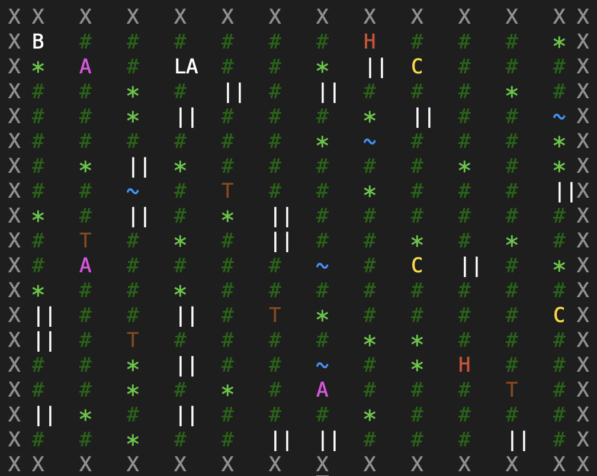

# 1. Архитектура (текстовое UML-описание)

## Классы и их ответственности

| Класс / интерфейс | Роль | Ключевые члены |
|---|---|---|
| `Base` (implements `Observer`) | Хранилище юнитов, «казарма» | `_units: dict[int, Unit]`, `_factory: UnitFactory`, `position`, `create_unit()`, `remove_unit()`, `get_unit()`, `on_unit_event()` |
| `Unit` (implements `Observable`) | Абстрактный юнит | `_id`, `_info: UnitTypeInfo`, `_current_health`, `_current_attack`, `_current_armor_bonus`, `_observers: list[Observer]`, `subscribe/unsubscribe/notify`, `move()`, `take_damage()`, `heal()`, `get_attack_boost()`, `get_resourses()`, `clone()` |
| `UnitTypeInfo` | «Легковес» — разделяемая неизменяемая информация о типе | `_pool: Dict[UnitType, UnitTypeInfo]`, `_max_health: Health`, `_base_armor: Armor`, `_base_attack: Attack`, `_base_speed`, `_cost`, `_type`; `get_info()` |
| `Terrain` (ABC) | Ландшафт | `is_passable()`, `get_speed_modifier()`, `get_armor_bonus()`, `symbol()`, `clone()` |
| `TerrainProxy` (inherits `Terrain`) | Обёртка над `Terrain` | `_real_terrain`, `_cache`, `_logger`; делегирует методы, кэширует, добавляет бонус брони пехоте |
| `NeutralObject` (ABC) | Нейтральный объект | `_strategy: InteractionStrategy`, `interact()`, `clone()`, `symbol()` |
| `InteractionStrategy` (ABC) | Поведение взаимодействия | `apply(unit)` |
| `TerrainMap` (implements `Observer`) | Карта | `_cells: Cell[][]`, `_terrain_factory`, `_neutral_obj_factory`, `get_cell()`, `render()`, `deep_copy()`, `on_unit_event()` |
| `Cell` | Клетка карты | `_terrain: TerrainProxy`, `_unit`, `_neutral`, `_base`, `place_unit()`, `remove_unit()`, `set_neutral()`, `take_neutral()`, `place_base()` |
| `UnitFactory` | Порождающий | `create_unit(kind, x, y)` |
| `RandomTerrainFactory` / `RandomNeutralObjFactory` | Порождающие | `create()` |
| `GameController` | Оркестратор сценариев | `setup_map()`, `setup_base()`, `spawn_unit()`, `move_unit()`, `interact()`, `run()` |

## Отношения (UML-нотация)

```
                ┌──────────────────────────────┐
                │           Observer           │◄──────────┐
                │  + on_unit_event(event)      │           │
                └──────────────▲───────────────┘           │
                               │ implements                 │ implements
                ┌──────────────┴────────────┐  ┌────────────┴────────────┐
                │            Base           │  │       TerrainMap        │
                │ - _units: dict[int, Unit] │  │ - _cells: Cell[][]      │
                │ - _factory: UnitFactory   │  │ - _terrain_factory      │
                │ + create_unit(kind,pos)   │  │ - _neutral_obj_factory  │
                │ + remove_unit(id)         │  │ + get_cell(pos)         │
                │ + get_unit(id)            │  │ + render()              │
                └───────┬───────────────────┘  └───────┬─────────────────┘
                        │ 1 creates / aggregates      │ 1..* contains
                        │ 0..*                        ▼
                        │                      ┌───────────────┐
                        ▼                      │     Cell      │
                ┌───────────────┐              │ - _terrain    │
                │     Unit      │◄─────────────│ - _unit       │
                │ - _info       │ 0..1         │ - _neutral    │
                │ - _observers  │              │ - _base       │
                └───┬───────┬───┘              └───────┬───────┘
                    │       │                          │ 1
                    │ 0..*  │ 1                        ▼
                    ▼       ▼                  ┌────────────────┐
             ┌──────────┐ ┌───────────────┐   │  TerrainProxy  │
             │ Observer │ │ UnitTypeInfo  │   │ - _real_terrain│
             └──────────┘ │ _pool: shared │   │ - _cache       │
                          └───────┬───────┘   └───────┬────────┘
                                  │ 1                 │ delegates
                                  ▼                   ▼
                         ┌────────┴────────┐   ┌──────────────┐
                         │ Health, Armor,  │   │   Terrain    │
                         │ Attack          │   │ (ABC)        │
                         └─────────────────┘   └──▲──▲──▲──▲──┘
                                                 │  │  │  │
                                      Plains ────┘  │  │  └──── Pathway
                                                    │  │
                                                Forest Swamp

                ┌─────────────────────┐        ┌─────────────────────┐
                │   NeutralObject     │◆──────►│ InteractionStrategy │
                │ - _strategy         │ 1    1 │ + apply(unit)       │
                │ + interact(unit)    │        └───▲────▲────▲────▲───┘
                └──────▲──────────────┘            │    │    │    │
       ┌───────────────┼───────────────┐  HealthRestore Damage Resource AttackBoost
       │               │               │
  TreasureChest     Trap            Altar          EnergySource
  (__radd__)     (__rsub__)      (__rmul__)       (__rtruediv__)
```

## Кратко о связях

- **`Base` ◆→ `Unit`** — агрегация/композиция: база создаёт юнитов через `UnitFactory`, хранит их в `_units`, удаляет по событию `DESTROYED`.
- **`Unit` ◆→ `UnitTypeInfo`** — общая (разделяемая) ссылка, отражает легковес.
- **`Unit` ◇→ `Observer`** — список подписчиков (`Base`, `TerrainMap`), оповещение через `notify(event)`.
- **`Base` и `TerrainMap` реализуют `Observer`** — принимают `UnitEvent`.
- **`Cell` ◆→ `TerrainProxy`**, `Cell ◇→ Unit`, `Cell ◇→ NeutralObject`, `Cell ◇→ Base`.
- **`TerrainProxy` ◆→ `Terrain`** — обёртка (прокси).
- **`NeutralObject` ◆→ `InteractionStrategy`** — стратегия подставляется в объект (в т.ч. динамически в `Altar.__rmul__`).
- **`TerrainMap` ◆→ `RandomTerrainFactory` / `RandomNeutralObjFactory`** — порождающие.

---

# 2. Паттерны

## 2.1 Наблюдатель (Observer)

**Где:** `observer.py` (`Observer`, `Observable`), `unit.py`, `base.py`, `terrain_map.py`, `unit_event.py`.

**Как реализовано:**
- `Unit` — субъект (`Observable`): хранит `_observers`, методы `subscribe/unsubscribe/notify`.
- `Base` и `TerrainMap` — конкретные наблюдатели, реализуют `on_unit_event(event)`.
- События `UnitEvent` (подтипы: `CreateEvent`, `DamageEvent`, `DestroyedEvent`, `ResourceEvent`) содержат `type`, `unit_id`, `position`, `timestamp` и специфичные поля (`damage`, `res_amount`).
- Оповещения происходят в `Unit.take_damage()` (→ `DamageEvent`/`DestroyedEvent`), `Unit.get_resourses()` (→ `ResourceEvent`), а `CreateEvent` генерируется в `GameController.spawn_unit()`.

**Реакции:**
- `Base` пополняет ресурсы (`GET_RESOURSES`), удаляет юнита из словаря при `DESTROYED`.
- `TerrainMap` убирает/ставит юнита в клетку по `event.position` при `DESTROYED`/`CREATED`.

**Преимущества:** слабая связанность — `Unit` ничего не знает о `Base`/`TerrainMap`; легко добавить нового наблюдателя (логгер, статистика) без изменения `Unit`.

## 2.2 Стратегия (Strategy)

**Где:** `strategies.py`, `neutral_object.py`.

**Как реализовано:**
- Интерфейс `InteractionStrategy.apply(unit)`.
- Конкретные стратегии: `AttackBoostStrategy` (+5 атаки), `HealthRestoreStrategy` (полное лечение), `DamageStrategy` (15 урона), `ResourceStrategy` (+50 золота).
- `NeutralObject` хранит ссылку `_strategy`; `Altar` сам выбирает стратегию по `unit.unit_type` (INFANTRY → AttackBoost, ARCHER/CAVALRY → HealthRestore).
- Взаимодействие реализовано через перегрузку операторов: `TreasureChest.__radd__`, `Trap.__rsub__`, `Altar.__rmul__`, `EnergySource.__rtruediv__` — юнит вызывает `unit + chest`, `unit - trap`, `unit * altar`, `unit / energy`, и объект применяет свою стратегию.

**Преимущества:** поведение объекта отделено от объекта; легко добавить новый эффект (новая стратегия) и новый объект (новая комбинация оператора и стратегии).

## 2.3 Легковес (Flyweight)

**Где:** `unit_type_info.py`.

**Как реализовано:**
- `UnitTypeInfo._pool: Dict[UnitType, UnitTypeInfo]` — пул разделяемых объектов.
- `get_info(unit_type)` возвращает уже существующий экземпляр; создание происходит один раз при инициализации (`tests.set_units_info()`).
- Внутреннее (intrinsic) состояние — `max_health`, `base_armor`, `base_attack`, `base_speed`, `cost`, `type` — общее для всех юнитов данного типа.
- Внешнее (extrinsic) состояние — `id`, `position`, `_current_health`, `_current_attack`, `_current_armor_bonus` — хранится в каждом `Unit`.

**Дополнительно:** `RandomTerrainFactory` также держит один набор экземпляров `Plains/Forest/Swamp/Pathway`, а `Cell` оборачивает их в `TerrainProxy` (а при копировании — клонирует).

**Преимущества:** экономия памяти при большом числе юнитов; единая точка изменения характеристик типа.

## 2.4 Прокси (Proxy)

**Где:** `terrain_proxy.py`.

**Как реализовано:**
- `TerrainProxy` реализует тот же интерфейс `Terrain` и хранит `_real_terrain`.
- `is_passable()` и `symbol()` — простая делегация.
- `get_speed_modifier()` — кэширование (`_cache[(«speed», unit_type)]`).
- `get_armor_bonus()` — добавляет пехоте `+0.25` к базовому бонусу ландшафта.
- `clone()` — создаёт новый прокси над `_real_terrain.clone()`.
- Логирование каждого обращения.

**Преимущества:** прозрачное расширение поведения без изменения `Terrain`; кэш; логи; возможность ленивой инициализации. `Cell` работает только с `TerrainProxy`, не зная о конкретном ландшафте.

---

# 3. Сценарии и результаты

Все сценарии выполняет `GameController.run()`: `setup_map(12, 17, 35)` → создание базы и юнитов → движение → нейтральные объекты → уничтожение юнита.

## Сценарий 1. Инициализация карты
`setup_map(12, 17, 35)`:
- Проверки: `1 ≤ width ≤ 50`, `1 ≤ height ≤ 30`, `1 ≤ max_units ≤ width*height//2` (35 ≤ 102 ✔).
- Создаётся матрица 17×12 клеток; в каждой — `TerrainProxy(RandomTerrainFactory.create())` и `RandomNeutralObjFactory.create()`.
- Распределение ландшафта: Plains 70 %, Forest 15 %, Swamp 5 %, Pathway 10 %.
- Распределение объектов: по 2 % на `EnergySource/Altar/Trap/TreasureChest` и 90 % — `None`.

**Результат:** карта готова, в логе — «Карта инициализирована».

## Сценарий 2. Создание базы и юнитов
`setup_base(200, 20, 1, (1,1))` + `spawn_unit("swordsman", (1,3))` + `spawn_unit("light_archer", (3,1))`:
- `Base` кладётся в клетку `(1,1)` (`Cell.place_base`).
- `spawn_unit` проверяет: клетка свободна (иначе `RuntimeError`), ландшафт проходим для типа (иначе `RuntimeError`).
- `Base.create_unit` → `UnitFactory` → `Swordsman`/`LightArcher` (id 0 и 1).
- `Unit.subscribe(TerrainMap)`; затем `notify(CreateEvent)` → `TerrainMap` ставит юнита в клетку.
- `interact(unit.id)` — если на клетке был нейтральный объект, он сразу применяется.
- Отрисовка карты (только в TTY).

**Результат:** в `_units` базы два юнита, оба стоят в клетках; в логе — «Создан swordsman на клетке (1, 3)», «Создан light_archer на клетке (3, 1)».

## Сценарий 3. Движение
`move_unit(0, (2,4))`, `move_unit(1, (3,2))`:
- Проверки: клетка свободна, ландшафт проходим, `dist(pos, target) ≤ unit.speed * terrain.get_speed_modifier(unit.unit_type)`.
- `speed_modifier`: Plains 1.0, Forest 0.5, Swamp 0.3, Pathway 2.0.
- `unit_cell.remove_unit()` → `unit.move(target)` → `target_cell.place_unit(unit)`.
- `interact(unit.id)` — если на целевой клетке объект, применяется.

**Результат:** юнит 0 перемещён с `(1,3)` на `(2,4)`, юнит 1 — с `(3,1)` на `(3,2)`; в логе — «Юнит (id: 0) переместился …».

## Сценарий 4. Нейтральные объекты
- `place_neutral_obj_at(Altar(), (3,3))` — `Cell.set_neutral`, перезаписывает случайный объект, если был.
- `place_neutral_obj_at(Trap(DamageStrategy()), (4,2))`.
- `move_unit(0, (3,3))` → в `interact` берётся `Altar`, применяется `Altar.__rmul__`: для INFANTRY — `AttackBoostStrategy` (+5 к атаке); `_strategy` временно сохраняется в `Altar._strategy`.
- `move_unit(1, (4,2))` → `Trap.__rsub__`: `DamageStrategy` → `unit.take_damage(15)`; фактический урон `15 − armor`, публикуется `DamageEvent` (или `DestroyedEvent`, если здоровья не хватило).
- Карта перерисовывается.

**Результат:** юнит 0 получает +5 атаки; юнит 1 теряет часть здоровья; в логе — «Юнит (id: 0) использовал A», «Юнит (id: 1) получил N урона».

## Сценарий 5. Уничтожение юнита с оповещением
`self._base.get_unit(0).take_damage(200)`:
- `actual = max(0, 200 − armor)`; здоровье обнуляется.
- Публикуется `DestroyedEvent(id=0, damage=200, pos=(3,3), timestamp)`.
- `Base.on_unit_event` → `remove_unit(0)`, `_count_units -= 1`.
- `TerrainMap.on_unit_event` → `get_cell((3,3)).remove_unit()`.
- Карта перерисовывается — юнита 0 больше нет.

**Результат:** в логе — «Юнит (id: 0) погиб (урон: 200)», «База удалила юнита (id: 0)»; в `_units` базы остаётся только id 1.

## Итоговая картина состояния после `run()`
| Объект | Состояние |
|---|---|
| Карта | 12×17, случайный ландшафт, случайные нейтральные объекты |
| База | (1,1), health 200, max_units 20, def_lvl 1, ресурсы могли пополниться при сборе сундуков |
| Юнит 0 (swordsman) | уничтожен, удалён из базы и из клетки (3,3) |
| Юнит 1 (light_archer) | жив, стоит в (4,2), возможно ранен `Trap`, атака могла быть усилена `Altar` (если тип совпал) |
| Журнал `game.log` | все `DEBUG/ERROR` сообщения с временем, именем логгера и текстом |


---

# 4. Вывод

- Архитектура модульная и соответствует принципам SOLID: у каждого класса одна ответственность, зависимости идут через абстракции (`Terrain`, `InteractionStrategy`, `Observer`/`Observable`).
- Четыре паттерна реализованы явно и уместно:
  - **Observer** разрывает связь `Unit` ↔ `Base`/`TerrainMap`;
  - **Strategy** делает поведение нейтральных объектов заменяемым;
  - **Flyweight** (`UnitTypeInfo._pool`) экономит память и централизует характеристики типов;
  - **Proxy** (`TerrainProxy`) прозрачно добавляет кэш, логирование и бонус брони пехоте.
- Механизм перегрузки операторов (`+`, `-`, `*`, `/`) даёт выразительный «синтаксис» взаимодействия: `unit + chest`, `unit - trap`, `unit * altar`, `unit / energy`.
- Сценарии `GameController` покрывают ключевые ветки: создание, движение с проверками, взаимодействие, смерть с двумя наблюдателями.

**Замечания:**
- `clone()` у нейтральных объектов и `RandomNeutralObjFactory` возвращают/копируют одни и те же экземпляры стратегий — при изменении состояния стратегии это скажется на всех объектах. Но в данной работе нейтральные объекты не имеют состояния, поскольку они просто дают некий бонус юнитам, поэтому это допустимо.
- `RandomTerrainFactory.create()` возвращает один и тот же экземпляр ландшафта, а `TerrainProxy` его оборачивает — допустимо, так как `Terrain` неизменяем.
- `_scenario_with_neutral_obj` вызывает `interact` внутри `move_unit`.
- в работе нет летающих юнитов, но есть ландшафт `Forest` (лес), через который не могут пройти тяжелые юниты.

**Общий итог:** проект демонстрирует корректное применение порождающих (фабрики) и поведенческих/структурных паттернов, обеспечивает расширяемость (новые типы юнитов, ландшафты, объекты и стратегии добавляются без правок существующего кода) и наблюдаемость через события.